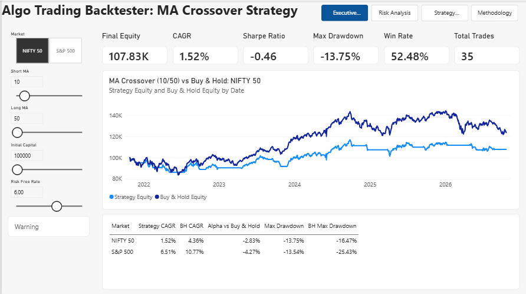
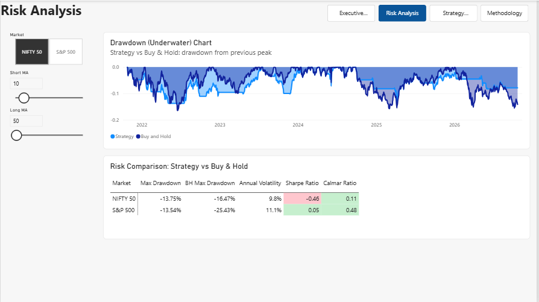
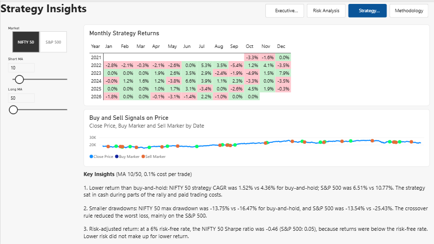

# Algorithmic Trading Backtesting and Risk Analytics (Power BI)

An interactive Power BI dashboard that backtests Moving Average crossover strategies on **NIFTY 50** and **S&P 500** over 5 years. Users change the Short MA, Long MA, starting capital and risk-free rate with sliders, and the equity curve, drawdown and risk metrics update instantly.

## Dashboard

### Executive Summary

### Risk Analysis

### Strategy Insights

## Tools
Python (pandas, yfinance), Power BI Desktop, Power Query, DAX, What-If parameters, star schema data model

## How it works
1. `python/data.py` downloads index prices and pre-computes the backtest for 159 Short/Long MA combinations on both markets (about 395,000 rows).
2. Power BI loads two fact tables (Prices, Backtest) and two dimensions (DimDate, DimMarket).
3. What-If sliders pick one MA combination, and DAX measures calculate CAGR, volatility, Sharpe ratio, max drawdown, Calmar ratio, win rate and trade count.

**Why Python for the backtest?** Path-dependent calculations such as running peaks are slow when nested inside DAX measures, so the heavy computation is done upstream and DAX handles the analytics.

## Key results (MA 10/50, 0.1% cost per trade)
| Market | Strategy CAGR | Buy and Hold CAGR | Strategy Max Drawdown | Buy and Hold Max Drawdown |
|---|---|---|---|---|
| NIFTY 50 | 1.52% | 4.36% | -13.75% | -16.47% |
| S&P 500 | 6.51% | 10.77% | -13.54% | -25.43% |

The crossover rule reduced the worst drawdown, especially on the S&P 500, but returned less than buy-and-hold.

## Validation
Power BI results were checked against the Python output at 10/50 with 100,000 starting capital:
NIFTY 50: final equity 107,830, 35 trades. S&P 500: final equity 136,970, 30 trades.

## Assumptions and limitations
Long-only, next-day execution (no look-ahead bias), 0.1% cost per trade, no slippage or taxes. Results are in-sample with no walk-forward test. Past performance does not guarantee future results.

## How to reproduce
1. `pip install yfinance pandas`
2. Run `python python/data.py` from the project folder (creates `data/prices.csv` and `data/backtest.csv`)
3. Open `powerbi/Backtester.pbix` in Power BI Desktop and update the data source paths if asked.

## More documentation
See the `docs` folder for DAX measures, data model and build steps.
